# Lab7Web_PHP — Praktikum 7: Pemrograman Server-Side dengan PHP

**Nama:** Alfy Ramadhan  
**Kelas:** I251C  
**NIM:** 312510298  
**Mata Kuliah:** Pemrograman Web  
**Program Studi:** Teknik Informatika

## Tujuan
- Memahami perbedaan pemrosesan client-side dan server-side.
- Menjalankan file PHP melalui server lokal.
- Menggunakan variabel, tipe data, operator, percabangan, perulangan, dan function.
- Menerima dan memproses data form dengan metode GET dan POST.
- Melakukan validasi dan sanitasi input dasar (`trim`, `filter_var`, `ctype_digit`, `htmlspecialchars`).
- Membangun aplikasi sederhana yang menerima, memproses, dan menampilkan data pengguna.

## Perangkat
- Laptop/PC dan web browser
- Visual Studio Code
- PHP + web server lokal (XAMPP/Laragon)

## Cara Menjalankan Server Lokal
1. Instal XAMPP atau Laragon, lalu jalankan layanan **Apache**.
2. Salin folder `Lab7Web_PHP` ke `C:\xampp\htdocs\` (XAMPP) atau `C:\laragon\www\` (Laragon).
3. Buka `http://localhost/Lab7Web_PHP/` di browser. **Jangan** membuka file PHP dengan klik ganda (kode PHP tidak akan dieksekusi).
4. Alternatif tanpa XAMPP: jalankan `php -S localhost:8000` di dalam folder proyek, lalu buka `http://localhost:8000/`.

## Struktur File
```
Lab7Web_PHP/
├── index.php            # Latihan 1 + menu semua latihan
├── latihan2.php         # Variabel, operator, percabangan
├── latihan3.php         # Perulangan dan array
├── latihan4.php         # Function
├── latihan5_cari.php    # Form GET
├── latihan6.php         # Form POST
├── latihan7.php         # Pengolahan data (subtotal transaksi)
├── mini_project/
│   ├── index.php        # Tampilan form + hasil
│   └── proses.php       # Logika validasi (dipisah dari tampilan)
├── eksperimen1.php      # Rata-rata tiga komponen nilai
├── eksperimen2.php      # Cari nama dari array (GET)
├── eksperimen3.php      # Function format Rupiah
├── eksperimen4.php      # Validasi NIM (angka, 9 digit)
├── eksperimen5.php      # Tombol reset vs proses ulang server
├── screenshots/         # Screenshot hasil dari browser (localhost)
│   ├── 01_latihan1.png
│   ├── 02_latihan2.png
│   ├── 03_latihan3.png
│   ├── 04_latihan4.png
│   ├── 05_latihan5_get.png
│   ├── 06a_latihan6_valid.png
│   ├── 06b_latihan6_kosong.png
│   ├── 06c_latihan6_html.png
│   ├── 07a_latihan7_valid.png
│   ├── 07b_latihan7_error.png
│   ├── 08a_mini_valid1.png
│   ├── 08b_mini_valid2.png
│   ├── 08c_mini_error1.png
│   ├── 08d_mini_error2.png
│   ├── 09_eksperimen1.png
│   ├── 10_eksperimen2.png
│   ├── 11_eksperimen3.png
│   ├── 12_eksperimen4.png
│   └── 13_eksperimen5.png
└── README.md
```

## Ringkasan Hasil
| File | Hasil yang diharapkan |
|---|---|
| `index.php` | Teks "PHP berhasil dijalankan" dan waktu server tampil; kode PHP tidak muncul sebagai teks. |
| `latihan2.php` | Siti: 85×0,30 + 78×0,30 + 90×0,40 = **84,90** → predikat **B**. |
| `latihan3.php` | 7 nama tampil sebagai daftar bernomor lewat `foreach`. |
| `latihan4.php` | Harga diskon 10% dari 150.000 = **Rp135.000**; luas 8×4 = **32**; function kelulusan jalan. |
| `latihan5_cari.php` | Setelah submit, URL berubah menjadi `?kata=...`, kata kunci tampil, dan kolom input tetap terisi. |
| `latihan6.php` | Data valid ditampilkan; input kosong menampilkan pesan wajib diisi (validasi server-side); tag HTML tampil sebagai teks. |
| `latihan7.php` | Subtotal dihitung; harga/jumlah tidak valid menampilkan pesan error. |
| `mini_project/` | Data valid menampilkan ringkasan; data tidak valid menampilkan seluruh pesan error. |

### Kasus Uji (Mini Project)
**Input valid**
1. Nama `Alfy Ramadhan`, NIM `312510298`, Prodi `Teknik Informatika`, Semester `3`, Email `alfyramadhan69@gmail.com` → ringkasan data tampil.
2. Nama `Siti`, NIM `123`, Prodi `Sistem Informasi`, Semester `14`, Email `siti@mail.co.id` → diterima (semester 14 adalah batas atas yang masih valid).

**Input tidak valid**
1. Semua kolom kosong → muncul pesan: Nama, NIM, Program studi wajib diisi; format email tidak valid; semester harus angka 1–14.
2. Semester `15` dan Email `alfy@` → muncul pesan "Semester harus berupa angka 1–14." dan "Format email tidak valid."

### Kasus Uji (Latihan 7)
- Valid: Barang `Buku`, Harga `15000`, Jumlah `3` → subtotal **Rp45.000**.
- Tidak valid: Nama barang diisi spasi saja (lolos atribut `required` di browser, tetapi menjadi kosong setelah `trim()` di server) → "Periksa kembali nama barang, harga, dan jumlah."  
  (Catatan: harga hanya menerima angka desimal biasa (maks. 2 desimal); notasi seperti `1e3` ditolak server. Untuk jumlah `0`, jumlah negatif, atau harga `abc`, atribut HTML `min`/`type=number` sudah memblokir di browser sebelum data sampai ke PHP, sehingga validasi server diuji lewat input spasi tersebut.)

## Bukti Screenshot

Semua screenshot diambil dari hasil eksekusi program di browser.

**Latihan 1 - PHP berhasil dijalankan**

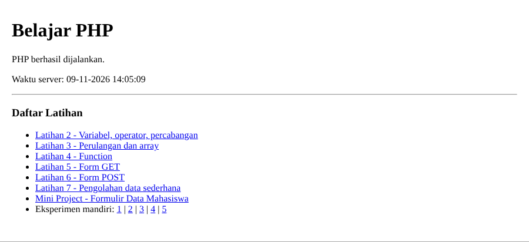

**Latihan 2 - Variabel, operator, percabangan**

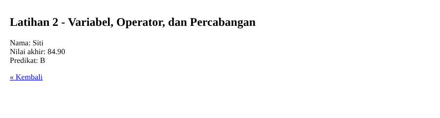

**Latihan 3 - Perulangan dan array**

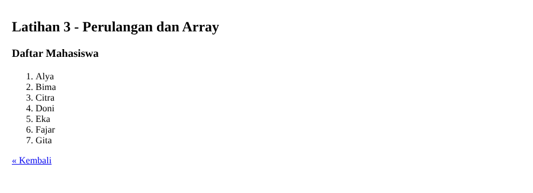

**Latihan 4 - Function**

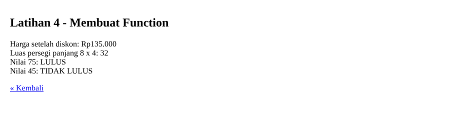

**Latihan 5 - Form GET**

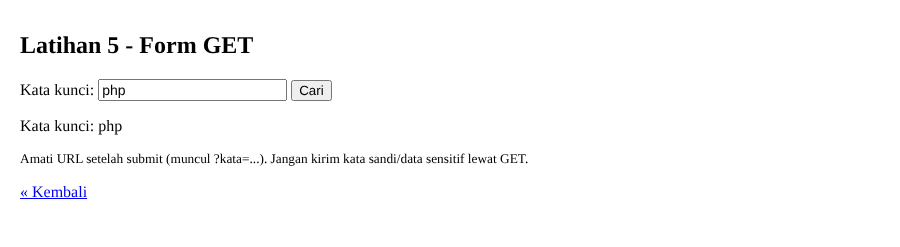

**Latihan 6 - Form POST, data lengkap**

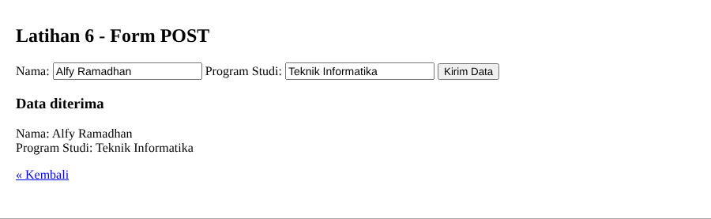

**Latihan 6 - Form POST, input kosong**

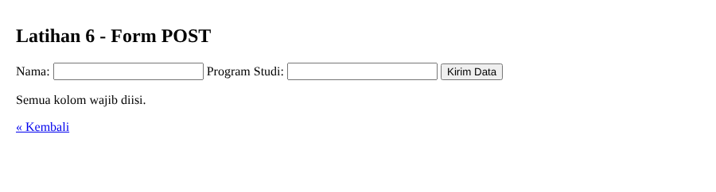

**Latihan 6 - Input tag HTML/tanda kutip tampil aman**


**Latihan 7 - Subtotal valid**

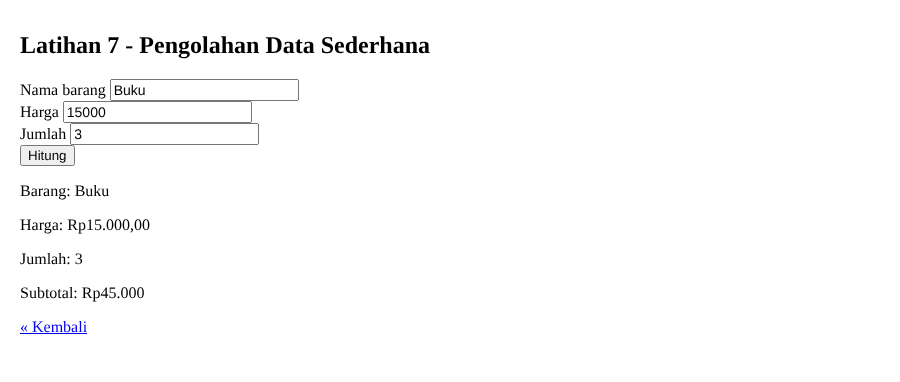

**Latihan 7 - Input tidak valid**

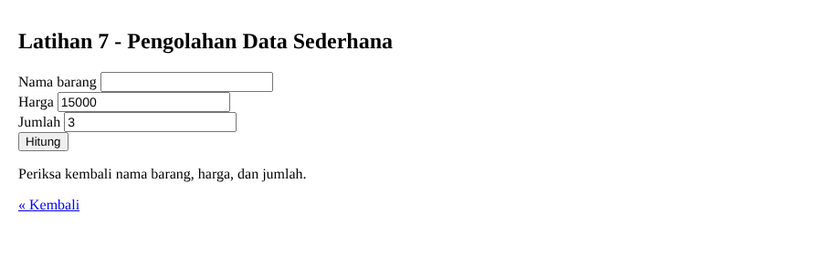

**Mini Project - Input valid**

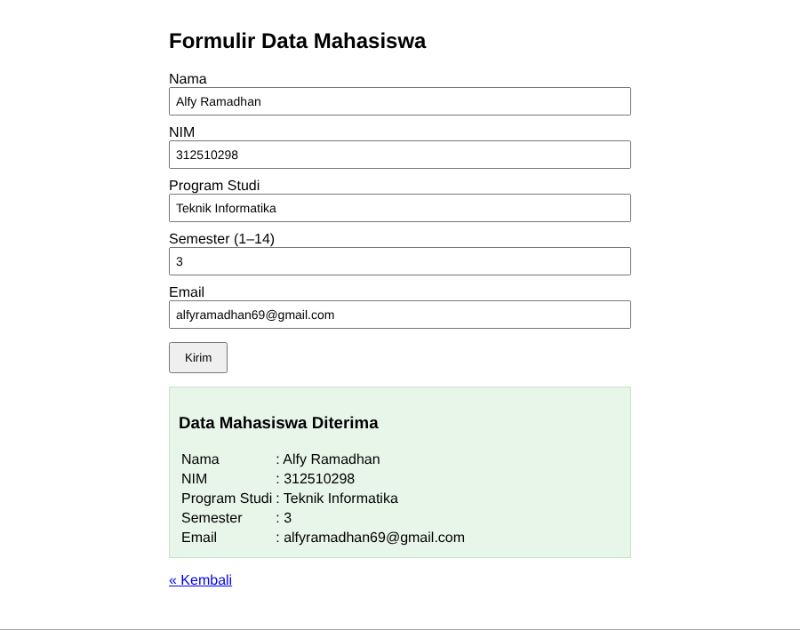

**Mini Project - Input valid (semester 14)**

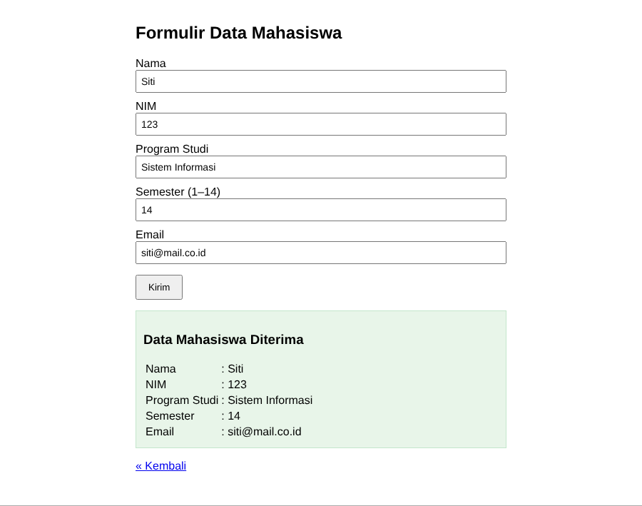

**Mini Project - Input tidak valid (semua kosong)**

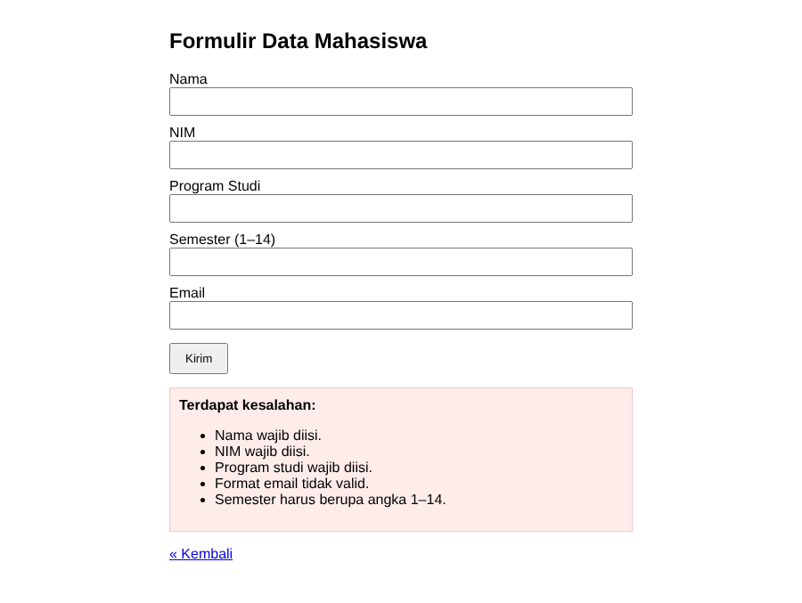

**Mini Project - Input tidak valid (semester 15, email salah)**

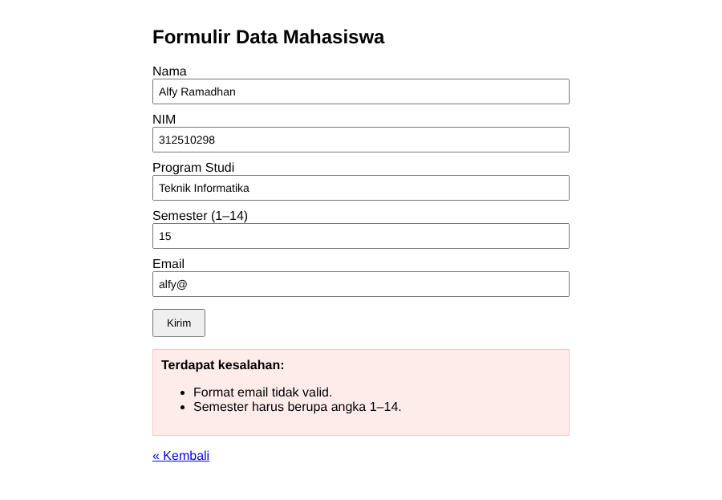

**Eksperimen 1 - Rata-rata nilai**

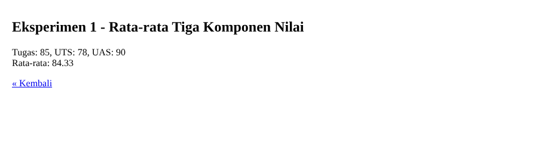

**Eksperimen 2 - Cari nama dari array**

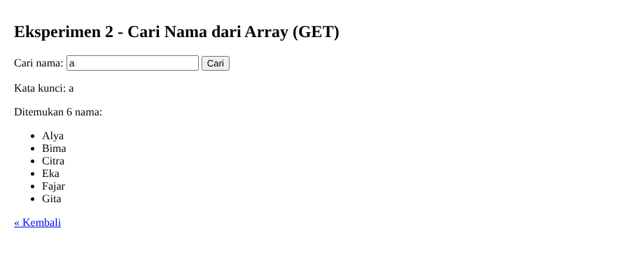

**Eksperimen 3 - Format Rupiah**

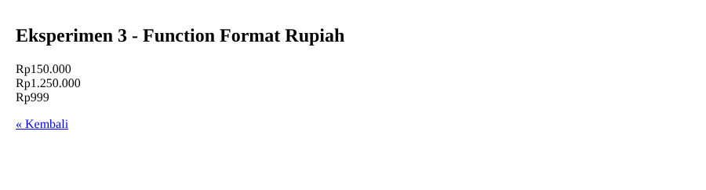

**Eksperimen 4 - Validasi NIM**

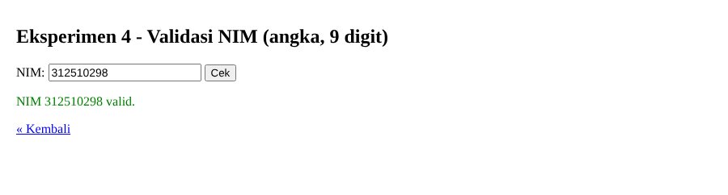

**Eksperimen 5 - Reset vs proses ulang**

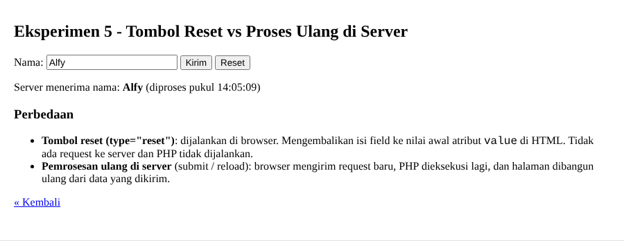


## Jawaban Pertanyaan Evaluasi
1. **Client-side vs server-side:** client-side dijalankan di browser pengguna (HTML, CSS, JavaScript); server-side dijalankan di server (menerima request, memproses input, menjalankan aturan aplikasi) lalu mengirim hasilnya (HTML) ke browser.
2. **Mengapa PHP harus lewat web server:** PHP harus diinterpretasi oleh engine PHP yang dipanggil web server. Jika dibuka dengan klik ganda (`file://`), browser hanya menampilkan teks file tanpa mengeksekusi PHP.
3. **Fungsi `$`:** penanda bahwa sebuah identifier adalah variabel PHP (contoh `$nama`).
4. **GET vs POST:** GET mengirim data lewat parameter URL (terlihat, cocok untuk permintaan yang tidak mengubah data, misalnya pencarian). POST mengirim data lewat body request (tidak tampil di URL, lazim untuk form). POST bukan enkripsi; gunakan HTTPS untuk melindungi data.
5. **Validasi server-side:** validasi di HTML/JavaScript bisa dilewati (misalnya lewat DevTools atau request manual), sehingga server tidak boleh percaya input dari klien. Validasi server adalah pemeriksaan utama.
6. **`htmlspecialchars()`:** mengubah karakter khusus HTML (`< > & " '`) menjadi entitas sehingga input pengguna tampil sebagai teks, bukan dieksekusi sebagai HTML/script (mengurangi risiko XSS).
7. **Manfaat function:** kode dapat dipakai ulang, program lebih rapi dan mudah dibaca, perubahan cukup di satu tempat, serta lebih mudah diuji.
